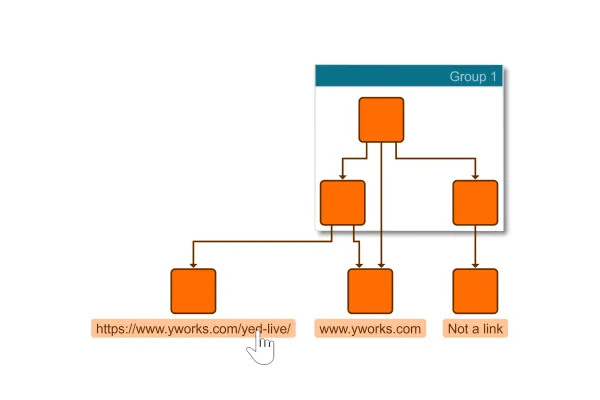

# External Links

This demo shows how to add labels that act like external links and open in a new window. It only follows the external link on a Ctrl click and works directly with ILabel text, so you can add new labels that represent links.
