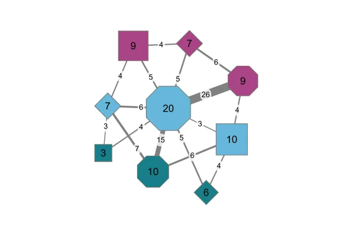

# Interactive Aggregation

This demo shows how to analyze a graph by aggregating groups of nodes. Via the context menu, groups of nodes of the same color or shape can be aggregated, giving different insights about the graph.
