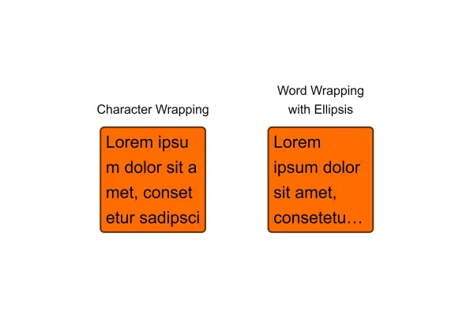

# Label Text Wrapping

This demo shows how to configure the text wrapping and trimming feature provided by the LabelStyle.
        Aside from wrapping in rectangular shapes, the TextWrappingShape property allows
        for wrapping in many more shapes like triangle, hexagon or ellipse.
