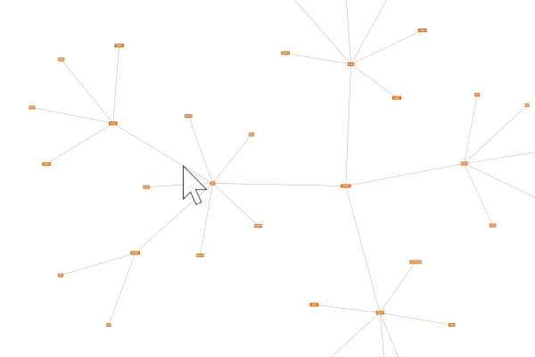

# Smart Click Navigation

This demo shows how to navigate in a large graph, especially when only part of the graph is visible in the viewport. Click nodes and edges to move the view to a useful point of interest.
